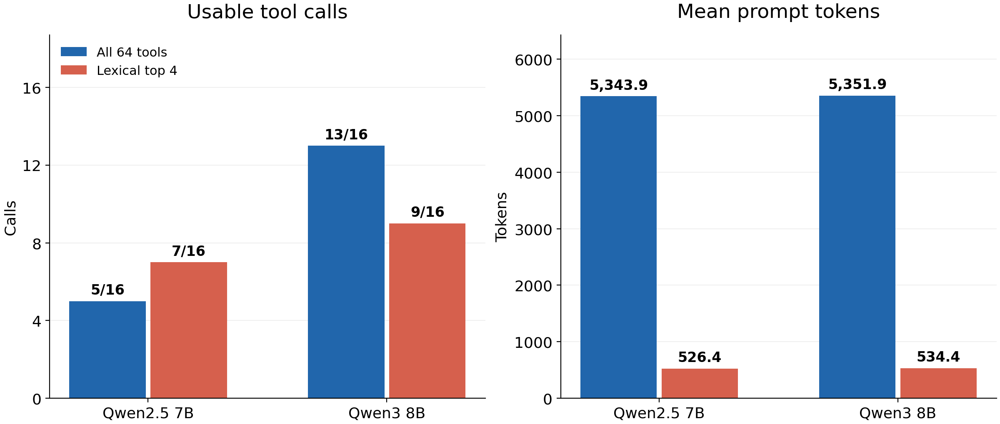

# Tool catalog prefilter pilot

A local synthetic comparison of all 64 function definitions versus a fixed lexical top-4 shortlist. Eight intent families each have an explicit-service request and one paraphrase: 16 authored requests, two conditions, two installed models, 64 planned native Ollama calls. Tool proposals are never executed against real services.

This is a new engineering pilot informed by [Anthropic's on-demand tool discovery discussion](https://www.anthropic.com/research/advanced-tool-use), not an implementation or reproduction of Anthropic Tool Search, an MCP compliance benchmark or a current-model ranking. Sources and data provenance: [SOURCES.md](SOURCES.md).

## Study contract

[PROTOCOL.md](PROTOCOL.md), [frozen manifest](evidence/frozen.json), [catalog](evidence/catalog.json), [cases](evidence/cases.json), [schedule](evidence/schedule.json) and [model digests](evidence/models.json) were saved before the first measured call. The original measured implementation is commit `5595caf429b3b757bd9d7e72593b9ed8ed12d498`.

The keyword retriever ranks distinct ASCII token overlap with the definition name and description, breaks ties by function name and returns four definitions even when overlap is zero. It never receives oracle labels, examples, embedding vectors or another model's answer. No fallback expands a missed shortlist.

Primary success requires a completed response with exactly one native tool call, the correct offered function, exact query and a schema-valid numeric integral limit. A hallucinated correct function outside the offered shortlist is a failure. Equivalent integer values such as 3 and 3.0 are accepted; booleans, extra arguments, malformed JSON and multiple calls fail. Function-name correctness and discovery recall are separate diagnostics.

## Operational amendment

After the first completed response, the original driver stopped at the next readiness check because unload after keep_alive=0 was asynchronous. No second call had been dispatched. [TRANSPORT-AMENDMENT.md](TRANSPORT-AMENDMENT.md) records the decision to preserve that response and continue the remaining 63 unissued cells, waiting read-only for an empty resident-model list. No model call was retried; prompts, cases, conditions, metrics and order were unchanged. Original stopped state is retained in [initial-stop.json](evidence/initial-stop.json). The continuation records its own source/amendment hashes before dispatch; its implementation is versioned in commit `5bc147b`. It is not part of the original frozen driver commit.

## Local setup

- Apple M1 Pro, 16 GiB, macOS 15.6.1; [host](evidence/host.json).
- Ollama 0.20.2; existing Qwen2.5 7B Q4_K_M and Qwen3 8B Q4_K_M; full digests in evidence/models.json.
- temperature=0, seed=20261111, think=false, num_ctx=16384, num_predict=160, stream=false, keep_alive=0, 90-second request timeout. One seed, serial requests, no new downloads or paid APIs.
- Before every request, resident model list must be empty. Caller response latency includes model loading and the API round trip; readiness wait and shortlist computation are excluded. These are cold-load observations, not production latency or dollar-cost estimates. A missing cache counter remains unknown.

## INVARIANT's actual role and accounting

[INVARIANT](https://github.com/Xenox-developer/invariant) 0.3.1 coordinated an isolated Codex implementation of the deterministic retriever/scorer, six protected acceptance tests, semantic review and verified host application. It did not execute the 64 measured Qwen calls; those run separately on the existing host Ollama server. The operational continuation adapter is separately authored and checked.

- Request: `tool-catalog-harness-20261111-v1`
- Study: `study-5fd20013ed6c4384b52a87c873640bf3`
- Attempt: `attempt-4186e2980232172ab7bf86b83aa10b75`
- Model/effort: gpt-6.1-sol / medium.
- Worker: 4 observed provider responses, 44,396 input + 1,196 output = 45,592 total tokens, including 32,128 cached input and 75 reasoning-output tokens as subsets.
- Semantic reviewer: 1 observed response, 4,460 input + 176 output = 4,636 tokens, including 124 reasoning-output tokens.
- Combined: 2 native sessions, 5 observed provider responses, 50,228 tokens. The tool's model_calls field counts two sessions, not five provider responses. No claim of one response per session.
- Outer chat token usage is unavailable. Implementation-agent usage and local Qwen measurement counters are different scopes; neither is an API bill estimate.
- Receipt: [evidence/invariant.json](evidence/invariant.json); fixed job: [invariant-job.json](evidence/invariant-job.json); reconciled worker observations: [invariant-worker-usage.jsonl](evidence/invariant-worker-usage.jsonl). Six tests passed, review approved and application verification succeeded. The worker's optional git diff check failed because its container snapshot was not a Git checkout; fixed acceptance and host diff checks passed.

## Recalculate saved results without model inference

```sh
python3 -B tests/run_checks.py
python3 -B recovery_checks.py
python3 analyze.py
python3 verify.py
python3 audit_transport.py
```

The original frozen files must remain unchanged. verify.py reconstructs every offered catalog and task score independently of tool_lab.select_tools/score, checks 64 unique cells and compares the saved aggregate. audit_transport.py additionally checks preserved original response bytes, source/amendment hashes, original scheduled order, all 64 empty-residency checks and that the 63 continued responses postdate the amendment.

Regenerate the chart with `python3 plot.py` and the pinned plotting dependency in requirements-plot.txt. Core collection/scoring uses Python's standard library. Never rerun inference in the recorded namespace. For an independently planned replication, copy the frozen design/code to a new clean results namespace and explicitly preregister its date/order/seed before `python3 run.py freeze` and `python3 run.py measure`; models must already be installed. No command automatically downloads models.

## Limits

All requests, labels and compact descriptions are AI-authored synthetic fixtures, not an externally validated sample. The eight paired intent families are the substantive units, not 16 independent tasks; there is only one seed and no confidence interval or significance claim. Paraphrases intentionally stress literal keyword discovery, and zero-score tie breaking is part of this simple baseline. These are older small local models, not proxies for current production agents. No absent-tool, multi-step search, real-service execution or general security benchmark is included. Distinguish retrieval misses from model routing and argument failures.

MIT-licensed code and newly authored synthetic fixtures. No credentials, Telegram source inventories, private messages or third-party article text are redistributed.

## Measured result

| Model | Exact usable calls: full64 → lexical4 | Mean prompt tokens: full64 → lexical4 |
|---|---|---|
| Qwen2.5 7B | 5/16 → 7/16 | 5,343.9375 → 526.375 |
| Qwen3 8B | 13/16 → 9/16 | 5,351.9375 → 534.375 |

Shortlist discovery recall was 9/16 (8/8 explicit names; 1/8 paraphrases). Qwen2.5 correct function selection fell from 14/16 to 9/16 despite its exact-call count increasing; quotation delimiters explain nine versus two correctly named calls failing exact query matching. See [RESULTS.md](RESULTS.md) for all strata, error types, timings and the transport deviation. [results/summary.json](results/summary.json) contains all derived observations; [evidence/raw.jsonl](evidence/raw.jsonl) retains every request/response. Independent score/catalog and transport audits passed all 64 cells.


